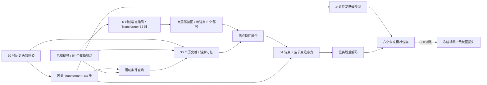

# 4DGS Viewport Prediction

当前实验方法的代码整理版：**Transformer 时序编码 + 高斯锚点图 + 头部运动条件记忆查询 + 位姿解码**。以最近 5 秒的头部轨迹及已知动态高斯场景为输入，预测未来位置与朝向。整理基于 2026-10-27 的 Actor1 对应帧重建实验，不是早期 PEARL / 流媒体调度代码。

当前网络 **96,589 个可训练参数**，同时输出 0.2 / 0.5 / 1 / 2 / 3 / 5 秒六个位姿；主要报告区间为 **1 / 3 / 5 秒**。

| 版本 | 网络与输入 | 训练监督 |
| --- | --- | --- |
| **NoRender** | 本仓库的完整 MotionQuery 网络 | 位置误差 + SO(3) 朝向误差 |
| **Full** | 与 NoRender 完全相同，种子相同时初始化相同 | 相同位姿损失 + 完整高斯贡献图辅助损失 |

**NoRender 仍然使用场景特征、图和记忆模块。** 它仅移除训练中的渲染监督，是检验该监督作用的主要参照。Full 在推理时不运行辅助损失渲染器，也不增加网络参数。

**使用前提：视频内容已知。** 模型读取目标时刻的高斯场景特征；未来用户头部位姿只出现在训练标签、监督和评估中。此设定适用于已知视频内容的视角预测，不等同于只用过去视频预测未知未来场景。

## 方法流程



详见 [方法与损失](docs/METHOD.md)、[数据接口与坐标约定](docs/DATA.md)、[复现步骤与边界](docs/REPRODUCIBILITY.md)。

## 安装与快速检查

Python ≥ 3.10；模型与 CPU 测试需要 PyTorch、NumPy、SciPy。实际核验环境为 Python 3.10、PyTorch 2.4.1+cu121、NumPy 1.26.4、SciPy 1.14.1。原生渲染另需匹配的 CUDA 扩展，见下文。

```bash
git clone https://github.com/AimerReol/4DGS-Viewport-Prediction.git
cd 4DGS-Viewport-Prediction
# 按自己的硬件先安装匹配的 PyTorch，然后安装本包。
python -m pip install -e .
python -m unittest discover -s tests -v
python -m motion_query_pose.cli --help
```

上述测试使用合成输入，无需数据集或 GPU。验证 Full / NoRender 初始化一致、输出形状、场景编码缓存等价、未来标签不进入前向、梯度有限及四元数符号不变性。

## 训练和推理

本仓库提供基于**已准备缓存**的训练入口。输入数据只读，结果写入另一个目录。

```bash
# 检查缓存、划分、时间索引、已记录的文件哈希
python -m motion_query_pose.cli inspect --data-dir /path/to/prepared

# NoRender：不需要原生高斯渲染器；训练入口使用 CUDA
python -m motion_query_pose.cli train \
  --data-dir /path/to/prepared --output-dir /path/to/run \
  --methods NoRender --splits R1 --seeds 0

# Full：先验证原生渲染器及姿态梯度，再计算训练集辅助损失尺度
python -m motion_query_pose.cli preflight \
  --data-dir /path/to/prepared --output-dir /path/to/run \
  --backend-dir /path/to/renderer-project --scene-dir /path/to/reconstruction
python -m motion_query_pose.cli calibrate \
  --data-dir /path/to/prepared --output-dir /path/to/run \
  --backend-dir /path/to/renderer-project
python -m motion_query_pose.cli train \
  --data-dir /path/to/prepared --output-dir /path/to/run \
  --backend-dir /path/to/renderer-project --methods Full

# 从可信检查点导出绝对位置、xyzw 四元数及逐区间位姿评分
python -m motion_query_pose.cli predict \
  --data-dir /path/to/prepared --output-dir /path/to/predictions \
  --checkpoint /path/to/run/weights/R1_Full_H50_seed0.pt \
  --split R1 --part test --device cuda
```

训练默认 3 划分 × 3 种子 × Full / NoRender，共 18 个模型。所有超参数保留当前实验设置；没有为了发布代码重跑训练或按测试结果调参。

## 代码索引

| 路径 | 用途 |
| --- | --- |
| `motion_query_pose/models.py` | 当前公开构造入口；Full / NoRender 的网络相同 |
| `motion_query_pose/v17_models.py` | 运动条件查询与完整 `run` 前向 |
| `motion_query_pose/v13_models.py` | 将基础时序模块替换为 Transformer，安装锚点记忆 |
| `motion_query_pose/base_model.py` | 场景编码、邻接图、锚点注意力和解码组件 |
| `motion_query_pose/backbones.py` | 因果 Transformer、锚点记忆与交叉注意力 |
| `motion_query_pose/previous_model.py` | 相对旋转四元数和 SO(3) 位姿损失；仅保留损失函数 |
| `motion_query_pose/rendering.py` | 高斯相机空间变换、可微贡献图监督 |
| `motion_query_pose/training.py` | 冻结配置下的训练、验证和最优权重保存 |
| `motion_query_pose/inference.py` | 检查点读取、世界坐标解码、位姿评分 |
| `motion_query_pose/preflight.py` | 原生渲染等价、随机投影、有限差分及组合梯度检查 |
| `motion_query_pose/calibrate.py` | 仅用训练记录计算渲染损失分母 |
| `motion_query_pose/validation.py` | 缓存完整性、划分和索引检查 |
| `reference/prepare_head_inputs.py` | Actor1 头部历史、标签与训练集归一化 |
| `reference/prepare_actor1_scene.py` | 现有重建到场景缓存的参考流程，依赖外部后端 |
| `provenance/` | 冻结源码哈希、整理差异与验证记录 |

保留 `v13` / `v17` 等历史模块名是为了兼容原检查点的参数键与初始化顺序，不代表这次运行多个历史模型。未使用的 KDA / Mamba 实现已从时序后端移除。

## 发布范围

此仓库整理当前方法；**不包含**原始轨迹、视频、PLY、重建权重、训练权重、服务器连接信息和其他论文基线源码。Full 所需的 `aps.backend` 及匹配版 `diff_gaussian_rasterization` 不在本仓库中，因此本次是方法代码发布，不是包含所有数据与外部渲染依赖的一键复现包。

Actor1 的标定为确认后的估计变换，场景仍有重建模糊；目前结果属于单场景探索性对比。参数量、均值领先和配对不确定性应分别报告，不能仅据此断言普遍泛化或“预测越长优势越大”。具体边界见 [复现说明](docs/REPRODUCIBILITY.md)，依赖与授权见 [NOTICE](NOTICE.md)。
